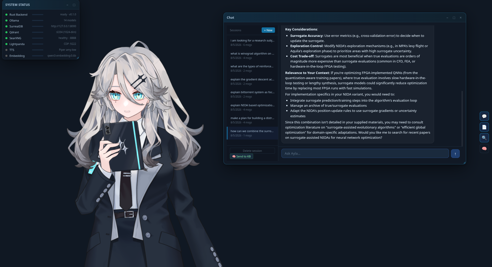
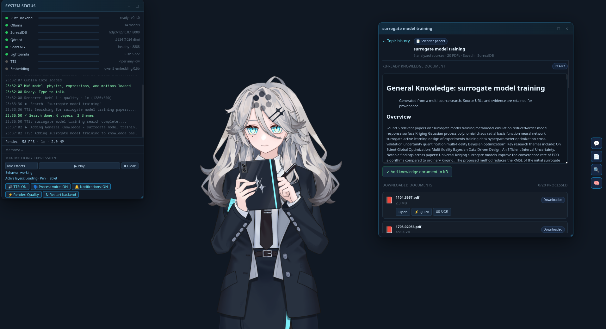
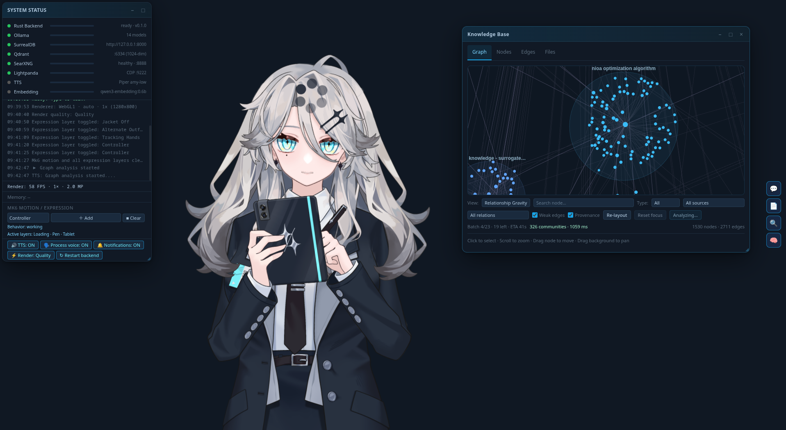
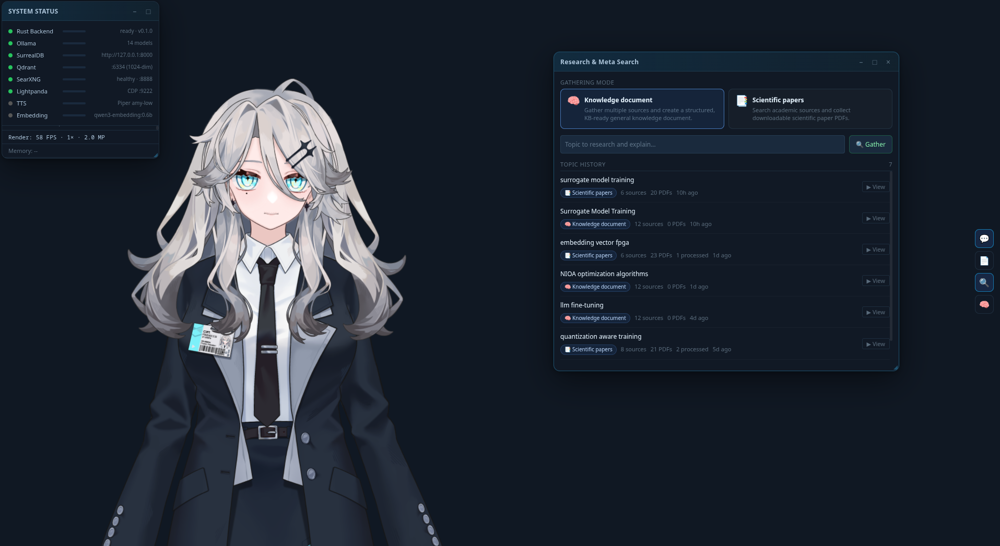
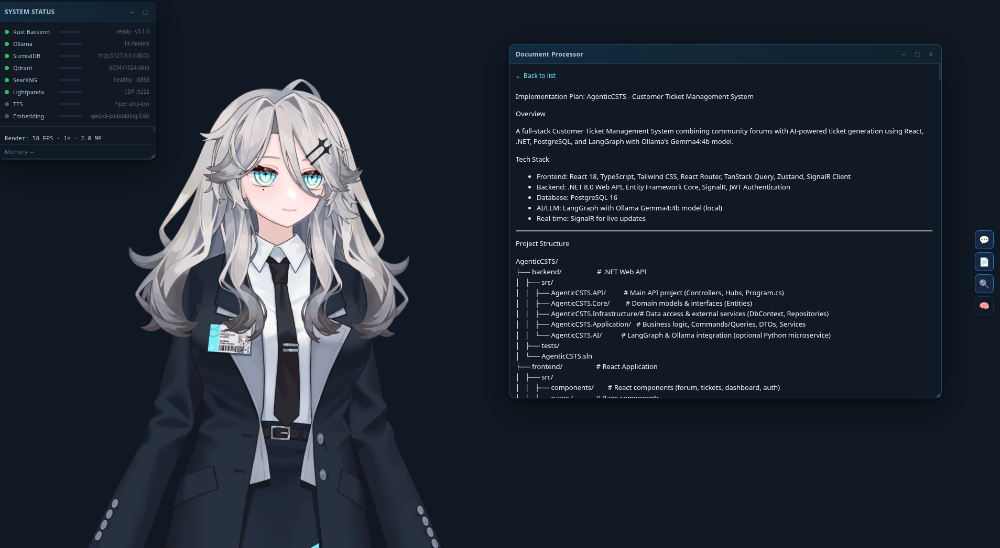
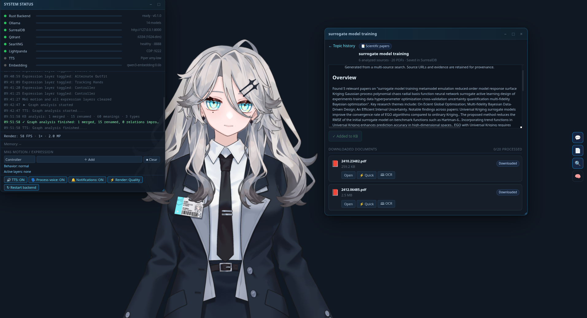

<p align="center">
  
</p>

<h1 align="center">Ayla</h1>

<p align="center"><strong>Local AI Coworker with Knowledge Memory</strong></p>

Ayla is a desktop AI coworker for conversation, research, document processing,
and long-term knowledge management. The interface combines a responsive Live2D
avatar with streaming chat, speech, OCR, meta-search, and a persistent knowledge
graph.

Ayla is presented as a capable colleague and research partner—not a demon,
servant, or roleplay character. Her runtime prompt emphasizes collaboration,
accuracy, user agency, useful initiative, and honest uncertainty.

Electron/Chromium is the primary high-performance desktop target. The Tauri
build remains available as a compatibility/reference host, and both use the
same Tauri-independent Rust backend.

## Screenshots

<p align="center">
  
</p>

<p align="center"><em>Streaming technical chat with persistent sessions, rich Markdown, process-aware Live2D posing, and the service dashboard.</em></p>

| Research and knowledge gathering | Knowledge graph analysis |
|---|---|
|  |  |
| General-knowledge synthesis, scientific PDFs, provenance, and KB approval. | Community/gravity graph view with incremental AI analysis and progress. |

| Persistent Meta Search | Document processing |
|---|---|
|  |  |
| General knowledge and scientific-paper modes with stored topic history. | Quick Extract/OCR results rendered for review before KB ingestion. |

<p align="center">
  
</p>

<p align="center"><em>Completed research retained in SurrealDB with downloaded-document Quick Extract and OCR actions.</em></p>

## Highlights

- **Streaming Ollama chat** with cancellable responses and selectable local or
  cloud models, including `gemma4:e4b` and `nemotron-3-super:cloud`.
- **Rich Markdown** rendered safely with DOMPurify, KaTeX mathematics, tables,
  links, and Highlight.js syntax coloring for a broad range of languages.
- **Partial-stream TTS** using Sherpa-ONNX/Piper. Ayla begins speaking complete
  prose segments before the LLM response finishes, while Markdown markers,
  code, equations, and tables are filtered from speech.
- **Process announcements and desktop notifications** for search, Quick
  Extract, OCR, knowledge ingestion, and graph analysis. Electron notifications
  include a KDE-compatible `notify-send` fallback on Linux.
- **Live2D Mk6 avatar** with cursor tracking, breathing, blinking, lip sync,
  authored expressions, idle/sleep/service-loss states, and tablet/pen process
  poses coordinated with chat and background work.
- **Adaptive rendering** with framebuffer pixel budgets, quality modes,
  resize-time throttling, visibility culling, and worker-assisted knowledge
  graph layout for smooth ultrawide/fullscreen Electron use.
- **Persistent memory** across conversations, episodes, semantic facts,
  documents, embeddings, and entity-relation knowledge.
- **Knowledge extraction** with automatic context sizing, bounded document
  chunks, relation-completion passes, JSON recovery, transient Ollama retries,
  and no default timeout for long generations.
- **Knowledge graph tools** with classic and community/gravity views,
  provenance-aware clusters, selected-neighbour highlighting, incremental AI
  cleanup, duplicate merging, node renaming/meaning improvement, deterministic
  relation normalization, checkpoints, and resume support.
- **Document lifecycle safety**: graph creation/deletion controls are kept out
  of the Graph tab. Deleting a document from Files removes only that source's
  vectors and graph provenance; shared knowledge survives while another source
  still supports it.
- **Meta Search** for general knowledge documents or scientific papers, backed
  by SearXNG and Lightpanda, with persistent topic history, downloaded PDFs,
  extracted/OCR text, reports, and knowledge-base ingestion state in SurrealDB.
- **Quick Extract and OCR** for uploaded or downloaded documents, with preview,
  persistence, approval, progress reporting, and long-running request support.

## Architecture

```text
┌──────────────────────────────────────────────────────────────┐
│ Shared Vite frontend                                        │
│ Panels · PixiJS/Live2D · Markdown/KaTeX · TTS queue         │
└──────────────────────┬──────────────────────┬────────────────┘
                       │                      │
             ┌─────────▼─────────┐  ┌────────▼──────────────┐
             │ Tauri 2 reference│  │ Electron 41/Chromium │
             │ thin command host│  │ sandboxed preload     │
             └─────────┬─────────┘  └────────┬──────────────┘
                       │           private framed MessagePack
                       │          ┌──────────▼──────────────┐
                       │          │ Rust sidecar           │
                       │          └──────────┬──────────────┘
             ┌─────────▼─────────────────────▼──────────────┐
             │ Shared Rust core                            │
             │ memory · DB · OCR/search · graph · TTS      │
             └──────┬────────────┬─────────────┬────────────┘
                    │            │             │
               SurrealDB      Qdrant        Ollama
               structured     vectors       chat/embed/OCR

             SearXNG + Lightpanda → web and paper research
```

The Electron page has no Node.js access. Electron main validates IPC commands,
owns the Rust sidecar, restricts navigation and external links, and forwards
versioned requests, events, streaming deltas, structured errors, cancellation,
and binary audio over private pipes.

### Technology

| Layer | Technology |
|---|---|
| Primary desktop host | Electron 41 / Chromium |
| Reference desktop host | Tauri 2 |
| Frontend | Vanilla JavaScript modules, Vite 5 |
| Avatar rendering | PixiJS 6, pixi-live2d-display, Cubism 4 |
| Markdown | marked, DOMPurify, KaTeX, Highlight.js |
| Rust backend | Cargo workspace: `ayla-core`, `ayla-sidecar`, `ayla-ocr`, `ayla-research` |
| LLM and embeddings | Ollama, configurable text model, `qwen3-embedding:0.6b` |
| Text-to-speech | Sherpa-ONNX Piper VITS (`amy-low`) |
| Structured storage | SurrealDB |
| Vector storage | Qdrant |
| Graph | Petgraph with SurrealDB persistence |
| Search | In-process `ayla-research` pipeline with SearXNG and Lightpanda |

### Rust Workspace Packages

| Package | Role |
|---|---|
| `ayla-core` | Host-independent application backend: memory, databases, knowledge graph, ingestion, chat orchestration, TTS, and the shared command API. |
| `ayla-sidecar` | Electron's private framed-MessagePack adapter. It owns `ayla-core`, dispatches validated commands, streams events/audio, and supports request cancellation. |
| `ayla-ocr` | In-process PDF rendering and page OCR through Ollama. It owns temporary render files and reports page-level progress without launching a helper executable. |
| `ayla-research` | In-process scientific research pipeline: SearXNG discovery, PDF download, Lightpanda rendering, extraction, Ollama analysis, and cross-source synthesis. |

The former `alice-core` and `alice-sidecar` packages were renamed to
`ayla-core` and `ayla-sidecar`. OCR and research were also moved from sibling
binary projects into the workspace as linked Rust libraries. Electron now
packages one Rust executable—`ayla-sidecar`—with OCR and research compiled into
it.

## Requirements

- Rust 1.77.2 or newer
- Node.js 22 LTS or newer recommended
- Docker with Compose
- Ollama
- Linux, Windows, or macOS for Electron
- Tauri platform dependencies only when building the reference Tauri host

The Mk6 Live2D model is licensed separately. Its source directory is gitignored
and is not redistributed by this repository.

## Quick Start

```bash
# Clone the renamed repository.
git clone <repo-url> Ayla
cd Ayla

npm install

# Create local service credentials. Replace both placeholder secrets.
cp .env.example .env
# Generate a secret with: openssl rand -hex 32

# Install the standard local models.
ollama pull gemma4:e4b
ollama pull qwen3-embedding:0.6b
ollama pull deepseek-ocr          # optional, used for PDF OCR

# Start persistent/search services.
docker compose up -d

# Verify the environment.
bash doctor.sh

# Primary desktop build.
npm run electron:dev
```

Install the licensed avatar as `Mk6_1.0/Mk6.model3.json`, or point
`AYLA_LIVE2D_MODEL_DIR` at its directory. OCR and scientific research require
no sibling repositories or separately built helper executables.

## Running and Building

```bash
npm run electron:dev              # Vite + debug Rust sidecar + Electron
npm run electron:start            # Electron against an existing dist/
npm run electron:stage            # Build and stage production resources
npm run electron:pack             # Unpacked production application
npm run electron:build            # AppImage and deb packages

npm run tauri dev                 # Reference Tauri host
npm run tauri build               # Reference Tauri packages

npm run test                      # JavaScript unit tests
npm run build                     # Frontend production build
npm run check                     # JavaScript tests + frontend build
```

Rust/Electron diagnostics:

```bash
npm run sidecar:diagnostic
npm run sidecar:diagnostic:live
npm run sidecar:diagnostic:mutations
npm run sidecar:diagnostic:features
npm run sidecar:diagnostic:ocr
```

## Configuration

Copy `.env.example` to `.env`. Important settings include:

| Setting | Purpose |
|---|---|
| `SURREAL_USER`, `SURREAL_PASS` | SurrealDB credentials |
| `SEARXNG_SECRET` | SearXNG session signing secret |
| `SEARXNG_URL` | SearXNG endpoint |
| `AYLA_LLM_MODEL` | Ollama text model |
| `AYLA_EMBED_MODEL` | Ollama embedding model |
| `AYLA_OCR_MODEL` | Ollama vision model used by the in-process OCR crate |
| `AYLA_OLLAMA_NUM_CTX` | Hardware-safe maximum context window |
| `AYLA_OLLAMA_LONG_TIMEOUT_SECS` | Long LLM/OCR timeout; `0` disables it |
| `AYLA_OLLAMA_TRANSPORT_RETRIES` | Transient extraction retry count, 0–10 |
| `AYLA_LIGHTPANDA_URL` | Lightpanda WebSocket endpoint used by research |
| `AYLA_LIVE2D_MODEL_DIR` | Licensed Mk6 model directory |

Context is selected automatically from the serialized prompt and requested
output budget, up to `AYLA_OLLAMA_NUM_CTX`. Do not set the ceiling to the
model's advertised maximum unless the available RAM/VRAM can support its KV
cache. Long extraction, graph analysis, and knowledge writing have no total
HTTP timeout by default. Temporary transport errors, rate limits, and common
5xx responses are retried without discarding chunks completed during the active
ingestion.

## Ayla's Character and Expression Contract

The active character prompt lives in `src/lib/prompts.js` as `CORE_IDENTITY`.
Ayla is defined as a trusted coworker and research partner:

- collaborative rather than obedient or submissive;
- concise, factual, and transparent about uncertainty;
- proactive about relevant risks and next steps;
- respectful of user agency and task boundaries;
- careful with private and persistent memory;
- warm when appropriate without performative roleplay.

Every chat response begins internally with one expression tag. The UI consumes
the tag, applies the matching Live2D expression, and excludes it from visible
Markdown and TTS output.

| Tag | Typical use |
|---|---|
| `[neutral]` | Normal answers, status, straightforward work |
| `[messy]` | Deep analysis, complex tradeoffs, conflicting evidence |
| `[surprised]` | Meaningful success or unexpected discovery |
| `[happy]` | Shared milestone, relief, genuine warmth |
| `[embarrassed]` | Ayla made a minor mistake or correction |
| `[confused]` | Ambiguity, uncertainty, failed dependency, risky outcome |
| `[angry]` | Serious preventable failure or credible threat; used rarely |
| `[tired]` | Long-running/repetitive work reaching a natural pause |

Process state is separate from expression state. Sleep mode activates after
user inactivity only when no background job is running. Chat responses use the
tablet pose; OCR, search, ingestion, and graph analysis use the tablet-and-pen
working pose. Expressions fade and are cleared across sleep/wake transitions.

## Panels

| Panel | Shortcut | Purpose |
|---|---:|---|
| System Status | — | Service health, FPS/render data, logs, TTS and notification controls |
| Chat | Ctrl+C | Streaming chat, sessions, Markdown/math/code, partial TTS, send-to-KB |
| OCR | Ctrl+O | Upload, Quick Extract/OCR, preview, persistence, KB approval |
| Meta Search | Ctrl+S | General knowledge or scientific papers, history, processing, ingestion |
| Knowledge Base | Ctrl+K | Graph views, community navigation, AI cleanup, node/edge/file inspection |

Panels are draggable, resizable, minimizable, and persisted between launches.

## Knowledge and Memory

| Layer | Storage | Purpose |
|---|---|---|
| Working memory | RAM | Current conversation context |
| Conversation memory | SurrealDB | Chat sessions and messages |
| Episodic memory | SurrealDB + Qdrant | Important past events |
| Semantic memory | SurrealDB | Facts and preferences |
| Knowledge graph | Petgraph + SurrealDB | Entities, meanings, relations, provenance |
| Document vectors | Qdrant | Semantic document retrieval |

The ingestion pipeline stores source text, selects an Ollama context, extracts
entities/facts/relations in bounded chunks, performs relation completion when a
chunk is fragmented, merges duplicate output, embeds document chunks, updates
memory stores, and synchronizes a bounded graph snapshot to SurrealDB.

AI graph cleanup first performs deterministic local normalization, then sends
only unresolved nodes, relation labels, and plausible duplicate candidates to
the LLM. Cloud models may run two batches concurrently; local models remain
sequential. Completed batches are checkpointed and can resume.

## Search and Documents

Meta Search provides two collection modes:

1. **General knowledge** gathers bounded public web evidence through SearXNG
   and writes a provenance-preserving Markdown reference document for the KB.
2. **Scientific papers** discovers and downloads PDFs, extracts metadata and
   text, and produces a cross-paper synthesis.

Search topics, reports, source records, downloaded PDFs, Quick Extract/OCR
outputs, and ingestion status are stored in SurrealDB. PDFs can be processed
with Quick Extract or the OCR model before KB approval.

## Rendering and Performance

Electron/Chromium is the recommended host for fullscreen and ultrawide use.
The renderer limits framebuffer megapixels instead of blindly using full device
pixel ratio, temporarily reduces quality during window resize, culls offscreen
graph content, throttles expensive streaming Markdown work, and offloads the
community/gravity layout to a worker. The Status panel can switch among Auto,
Quality, and Performance modes and displays current FPS and render resolution.

## Project Layout

```text
Ayla/
├── src/                         frontend, panels, Live2D, Markdown, TTS queue
├── styles/                      blue Ayla UI theme and panel styles
├── Cargo.toml                   Rust workspace definition
├── crates/
│   ├── ayla-core/               shared host-independent application backend
│   ├── ayla-sidecar/            Electron MessagePack protocol adapter
│   ├── ayla-ocr/                in-process PDF rendering and Ollama OCR
│   └── ayla-research/           in-process search, download, analysis, synthesis
├── electron/                    secure main/preload, protocol, packaging tools
├── src-tauri/                   thin reference Tauri host
├── searxng/                     local search configuration
├── docker-compose.yml           SurrealDB, Qdrant, SearXNG, Lightpanda
├── Mk6_1.0/                     licensed avatar files; local and gitignored
├── tts/                         local Piper/Sherpa resources
├── MASTER_PLAN.md               historical architecture plan
├── ELECTRON_RUST_MIGRATION_PLAN.md
└── TEST_PLAN.md
```

First-party runtime identifiers now use Ayla consistently: Rust packages use
`ayla-*`, Rust imports use `ayla_*`, Electron IPC channels use `ayla:*`, and
application-specific environment variables use the `AYLA_*` prefix.

## Testing

```bash
bash doctor.sh --quick --no-docker --no-ollama
bash doctor.sh
cargo test --workspace
cargo check --manifest-path src-tauri/Cargo.toml
npm run check
```

See `TEST_PLAN.md` for manual workflows and performance checks.

## License

MIT License

Copyright (c) 2026 Ayla contributors

Permission is hereby granted, free of charge, to any person obtaining a copy
of this software and associated documentation files (the "Software"), to deal
in the Software without restriction, including without limitation the rights
to use, copy, modify, merge, publish, distribute, sublicense, and/or sell
copies of the Software, and to permit persons to whom the Software is
furnished to do so, subject to the following conditions:

The above copyright notice and this permission notice shall be included in all
copies or substantial portions of the Software.

THE SOFTWARE IS PROVIDED "AS IS", WITHOUT WARRANTY OF ANY KIND, EXPRESS OR
IMPLIED, INCLUDING BUT NOT LIMITED TO THE WARRANTIES OF MERCHANTABILITY,
FITNESS FOR A PARTICULAR PURPOSE AND NONINFRINGEMENT. IN NO EVENT SHALL THE
AUTHORS OR COPYRIGHT HOLDERS BE LIABLE FOR ANY CLAIM, DAMAGES OR OTHER
LIABILITY, WHETHER IN AN ACTION OF CONTRACT, TORT OR OTHERWISE, ARISING FROM,
OUT OF OR IN CONNECTION WITH THE SOFTWARE OR THE USE OR OTHER DEALINGS IN THE
SOFTWARE.

The separately licensed Mk6 Live2D model files are not covered or redistributed
by this repository's MIT license.
